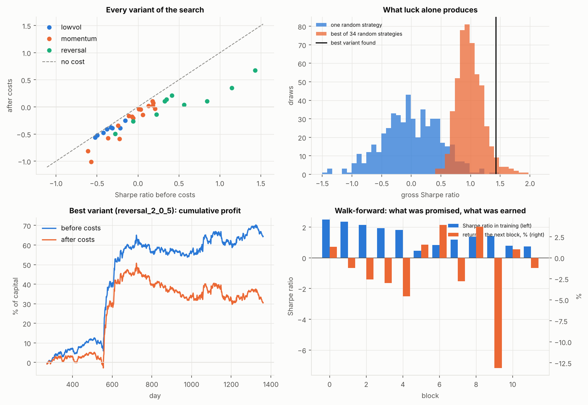

# BackLab

A cross-sectional equity backtester in Rust, with no dependencies, built around one question: how much of this Sharpe ratio is luck?

Every backtest here comes with three answers to that question. Random portfolios built with exactly the same rules give the distribution of the Sharpe ratio when there is no signal at all. The best of N random strategies gives the bar that the winner of a search over N variants has to clear. Walk-forward selection shows what choosing the winner in real time would have earned.

## What is inside

| Layer | Modules (`engine/src`) | Content |
|---|---|---|
| `data` | `panel`, `csv` | validated price panel, daily returns |
| `signal` | `momentum`, `reversal`, `lowvol`, `combine` | signals behind one trait, with an explicit warm-up |
| `portfolio` | `weights`, `costs` | rank-based long-short and long-only weights, turnover, proportional costs |
| `engine` | `backtest`, `grid`, `walkforward` | the day loop with drifting positions, parameter grids on a common start day, walk-forward selection |
| `metrics` | `performance`, `drawdown`, `sharpe_stats` | returns, drawdowns, standard error of the Sharpe ratio with skewness and fat tails, expected maximum of a search, deflated Sharpe ratio |
| `inference` | `permutation`, `bootstrap` | random-portfolio nulls, single and best-of-N, stationary bootstrap intervals |
| `math` | `rng`, `normal`, `stats` | generator, normal distribution, ranking |

Timing is fixed in one place: a signal from prices up to the close of day t sets the weights at that close and first earns the return of day t + 1. Two tests change every price after a given day and require signals and past returns to stay identical.

## Results

300 Nasdaq stocks, 1,362 days. Long the top 20% of a signal, short the bottom 20%, equal weights. A search over 34 variants of momentum, short-term reversal and low volatility, all traded over the same 1,091 days. Full tables in `reports/report.md`.

**The search finds a winner**: two-day reversal rebalanced every five days, gross Sharpe ratio 1.43.

**How real is it?**

| Question | p-value |
|---|---|
| Is the Sharpe ratio above zero, taken alone? | 0.0008 |
| Do random portfolios built the same way do as well? | 0.004 |
| Does the best of 34 random strategies do as well? | 0.040 |

The same number goes from overwhelming to borderline once the search is counted. The best of 34 strategies with no signal has a Sharpe ratio of 0.99 on average, and 1.37 one time in twenty.

**After costs.** The strategy trades 78 times its capital a year. At 10 bp per unit traded the Sharpe ratio falls from 1.43 to 0.67, with a bootstrap 95% interval of -0.59 to 1.84. It breaks even at 19 bp.

**Where the profit came from.** Of the 64% cumulative gross profit, 43 points were made in about 70 days around the market crash in the sample. After costs, the rest of the period loses money.

**Choosing without hindsight.** Selecting every 63 days the variant with the best Sharpe ratio over the previous 378 days: the chosen variants had a mean Sharpe ratio of 1.46 in training and earned -0.51 afterwards, beating only 3 of the 34 variants held throughout.



## Reading the numbers

- The conclusion is negative: on this panel, none of the 34 variants is a strategy one could defend. That is the result, not a failure of the tool.
- The universe contains only stocks that survived the whole period, and only closing prices. There is no bid-ask spread, no market impact, no borrow cost and no check that the short leg could be borrowed. Real short-term reversal is hurt by all of these.
- Five and a half years with one crash is a short sample. The standard error of an annual Sharpe ratio over this period is about 0.45, so nothing below about 0.9 can be told from zero even before any search.
- The best-of-N null treats the 34 variants as unrelated. They are correlated (mean absolute correlation 0.41), so the true bar is somewhat lower and the corrected p-value of 0.04 is conservative. The analytic expected maximum (0.99) makes the same assumption and agrees with the simulation.
- The random-portfolio null keeps the universe, the days, the number of names and the rebalancing dates. It does not keep the turnover of a slow signal, so it is used on returns before costs only.
- Walk-forward switching between variants is not charged, only each variant's own trading. This flatters the selection, which still loses.
- Positions drift with prices between rebalances; capital is constant, profits are added and not compounded.

## Run it

```
pip install -e ".[dev]"
make build      # cargo build --release
make test       # cargo test, then pytest
make run        # writes reports/, about one minute
```

```
python scripts/backtest.py signal=reversal lookback=2 rebalance=5 cost_bps=10
python scripts/backtest.py prices=my_prices.csv signal=momentum lookback=120 skip=20
python scripts/search.py 200
```

A new signal is one trait implementation (`engine/examples/custom_signal.rs`):

```rust
use backlab::engine::backtest::{run, Config, Mode};
use backlab::{Panel, Signal};

struct BelowHigh { lookback: usize }

impl Signal for BelowHigh {
    fn name(&self) -> String { format!("below {}-day high", self.lookback) }
    fn warmup(&self) -> usize { self.lookback }
    fn score(&self, panel: &Panel, day: usize, out: &mut [f64]) {
        for (i, o) in out.iter_mut().enumerate() {
            let high = (day - self.lookback..=day).map(|t| panel.price(t, i)).fold(f64::MIN, f64::max);
            *o = 1.0 - panel.price(day, i) / high;
        }
    }
}
```

## Layout

```
engine/src/        data, signal, portfolio, engine, metrics, inference, math, command line binary
engine/tests/      integration tests, one file per subject, with shared synthetic panels
engine/examples/   three short programs
src/backlab/       Python driver, report and figure
data/              the price panel and its description
configs/           the search and the cost assumptions
docs/              methods
reports/           report, validation table, metrics, figure
```

## Author

Amir Masominia. PhD in physics (Université Paris-Saclay); postdoctoral researcher working on machine-learning surrogate models, numerical simulation and automated measurement pipelines.

MIT licence.
